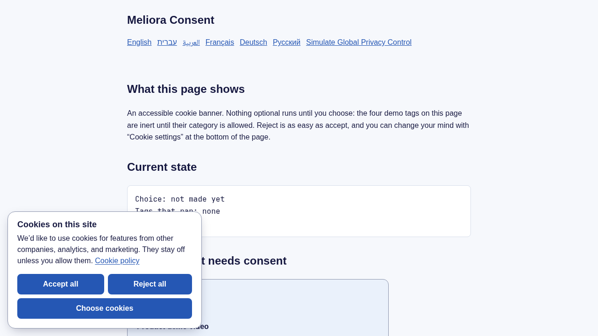
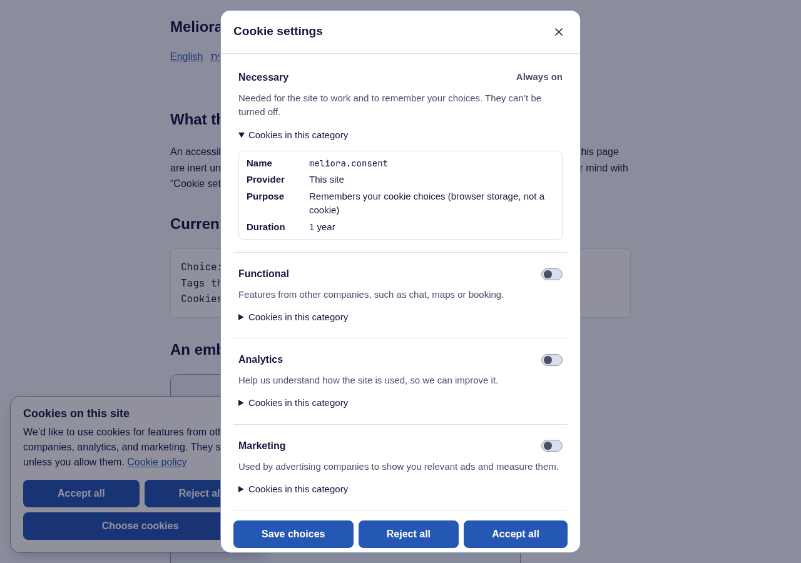
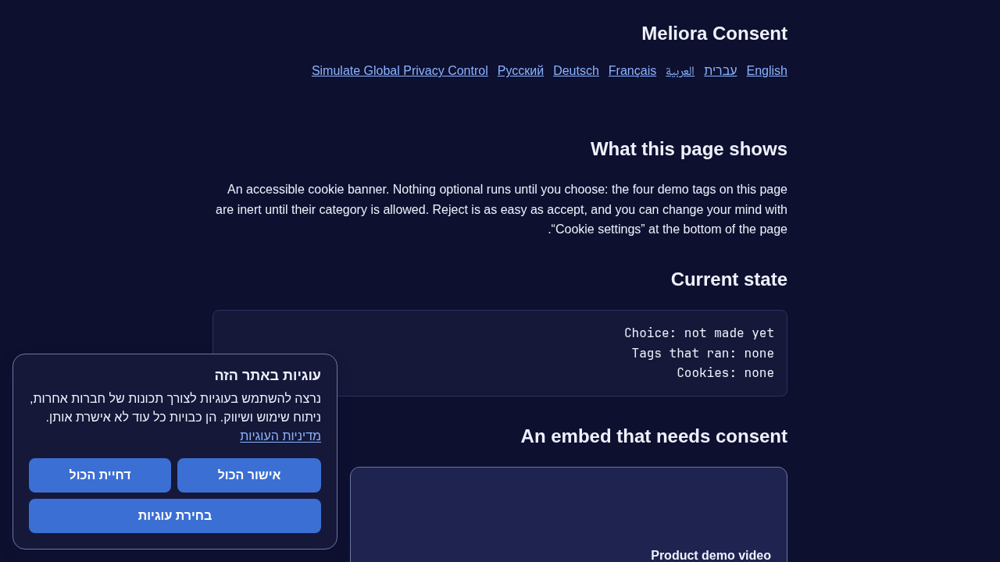
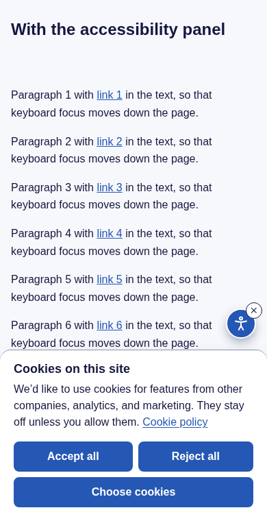

<p align="center">
  
</p>

<h1 align="center">Meliora Consent</h1>

<p align="center">
  An accessible cookie banner for any website.<br>
  Reject as easy as accept · Google Consent Mode v2 · ten languages · no dependencies · no tracking.
</p>

<p align="center">
  <a href="https://melioradev.github.io/meliora-consent/"><strong>Live demo</strong></a> ·
  <a href="#install">Install</a> ·
  <a href="#configuration">Configuration</a> ·
  <a href="#license">License</a>
</p>

<p align="center">
  
  &nbsp;
  
</p>
<p align="center">
  
  &nbsp;
  
</p>

---

## What it does

- **Nothing optional runs before a choice.** Analytics, marketing and other third-party scripts stay inert until their category is allowed. Ignoring the banner is not consent.
- **Reject is as easy as accept.** "Accept all", "Reject all" and "Choose cookies" sit together on the first layer, in exactly the same style. There's no × and no "by continuing to browse…".
- **Specific choices.** The settings dialog has a switch per category (functional, analytics, marketing) and lists each category's cookies.
- **Easy to withdraw.** A "Cookie settings" button in your footer reopens the dialog. Turning a category off deletes its declared first-party cookies and reloads the page.
- **Embeds wait too.** YouTube videos, maps and other iframes get an accessible placeholder with an "Allow and show" button.
- **Google Consent Mode v2** defaults and updates, set before any Google tag loads.
- **Global Privacy Control** is honored: marketing stays off.
- **Accessible:** keyboard-first, WCAG 2.1 AA, never hides the element that has focus, works at 200% zoom and 320px width. The settings dialog is a native `<dialog>` with a focus trap and Esc.
- **Follows the page language** (`<html lang>`), with right-to-left Hebrew and Arabic.
- **Works with [Meliora Accessibility](https://github.com/melioradev/meliora-accessibility):** the banner stays clear of its button and follows its High contrast, Stop animations and text size settings.
- **No banner when there's nothing to ask.** With no optional categories configured, it does nothing.
- **Strict CSP friendly:** no inline scripts or styles, no requests to anyone but your own site.

## Languages

English (default) · العربية · 中文（简体） · Français · Deutsch · עברית · Italiano · Русский · Español · Українська

The banner uses the page's `<html lang>` and falls back to English. All strings are in [`src/meliora-consent-i18n.js`](src/meliora-consent-i18n.js), and every one can be overridden from the config. Corrections from native speakers are very welcome.

## Install

One line in your page's `<head>`, **without** `defer`, before any tracking script:

```html
<script src="https://cdn.jsdelivr.net/gh/melioradev/meliora-consent@v0.2.0/dist/meliora-consent.min.js"
        data-policy="/privacy/" data-policy-version="2026-11-15" data-categories="analytics marketing"></script>
```

Then tag your tracking scripts with their category (below), and add a **Cookie settings** button to your footer:

```html
<button type="button" data-consent-open hidden>Cookie settings</button>
```

It starts hidden and appears only when there are choices to make, so it never shows without JavaScript. If you use [Meliora Accessibility](https://github.com/melioradev/meliora-accessibility) 1.1.0 or later, its menu also offers "Cookie settings".

The file loads its own stylesheet from next to itself. The [demo page](https://melioradev.github.io/meliora-consent/#install-title) builds the whole snippet for you.

| Attribute | What it sets |
|---|---|
| `data-categories` | The categories your site uses: `functional`, `analytics`, `marketing` (separated by spaces). |
| `data-policy` | Link to your cookie or privacy policy. |
| `data-policy-he`, `data-policy-ar`, … | The policy in another language. |
| `data-policy-version` | Change it whenever your cookies or wording change: everyone is asked again. |
| `data-consent-mode="false"` | You don't use Google tags: skip Consent Mode. |
| `data-gpc="false"` | Don't apply Global Privacy Control. |
| `data-renew-days` | Ask again after this many days (default 365). |
| `data-cookie-domain` | Share the choice with subdomains, e.g. `.example.com`. |
| `data-log` | URL that receives each choice as proof of consent ([example Worker](examples/consent-log-worker.mjs)). |
| `data-insert-after` | CSS selector to place the banner after in the DOM. |
| `data-css="none"` | Don't load the stylesheet; include `dist/meliora-consent.css` yourself. |

To list each cookie in the settings dialog, add `window.MelioraConsentConfig` (see [Configuration](#configuration)) in a file loaded just before the script. It wins over the attributes.

**Self-hosting:** copy `dist/meliora-consent.js` and `dist/meliora-consent.css` into the same folder on your site. With a strict Content-Security-Policy, self-hosting needs no extra rules; loading from jsDelivr needs `https://cdn.jsdelivr.net` in `script-src` and `style-src`. The separate files in `src/` (as in 0.1.0) still work.

### Tagging scripts

- `type="text/plain"` makes the browser ignore the script. `data-consent` names its category: `functional`, `analytics` or `marketing` (several, separated by spaces, means all are needed).
- When the category is allowed, the script is re-created as a real script, in document order. Scripts without `async` keep their order. Use `data-type="module"` for module scripts.
- Prefer external files. Inline tagged scripts only run if your Content-Security-Policy allows them (a nonce is copied over).
- Add each vendor's domains to your CSP as usual.

### Embeds

```html
<iframe data-consent="marketing" data-src="https://www.youtube.com/embed/…" data-provider="YouTube"
        title="Product demo video" width="560" height="315"></iframe>
```

Until the category is allowed, a placeholder takes the iframe's place: "This content is from YouTube. Showing it allows marketing cookies.", with "Allow marketing cookies and show" and "Cookie settings" buttons.

## Configuration

For cookie lists and everything else, put this in its own file (so your CSP can stay strict) and load it just before the banner's script:

```js
window.MelioraConsentConfig = {
  policyUrl: {default: '/privacy/', he: '/he/privacy/'}, // or one URL
  policyVersion: '2026-11-15',      // change it when the cookie list or wording changes: everyone is asked again
  necessary: {cookies: [/* listed in the dialog, never blocked */]},
  categories: {                     // only the categories you list appear
    analytics: {
      cookies: [
        {name: '_ga', provider: 'Google Analytics', purpose: {default: 'Tells visitors apart', he: '…'}, duration: {default: '2 years', he: '…'}},
        {name: '_ga_*', provider: 'Google Analytics', purpose: {default: 'Keeps the session state'}, duration: {default: '2 years'}},
      ],
      storageKeys: [],              // localStorage keys to delete when the category is withdrawn
    },
    // functional: {...}, marketing: {...}
  },
  googleConsentMode: true,          // false if you don't use Google tags
  adsDataRedaction: true,
  honorGPC: true,
  renewAfterDays: 365,              // 180 for French audiences (CNIL)
  cookieDomain: null,               // e.g. '.example.com' to share the choice with subdomains
  logEndpoint: null,                // e.g. '/api/consent': see examples/consent-log-worker.mjs
  insertAfter: null,                // CSS selector; default: after the accessibility button, or the skip link
  text: {},                         // string overrides per language, e.g. {he: {title: '…'}, default: {…}}
};
```

Cookie names ending in `*` match by prefix. List every cookie your site sets: this repository's tests fail on undeclared cookies, and yours should too.

### Theming

The banner uses your site's CSS custom properties when they exist, and light defaults otherwise. They're the same ones Meliora Accessibility uses:

`--ink` (text) · `--muted` · `--surface` (background) · `--tint` (hover) · `--line` (borders) · `--field-border` · `--brand` (links) · `--button` / `--button-hover` · `--focus`

Define them for your dark theme and the banner follows.

## Google Consent Mode v2

The boot script calls `gtag('consent', 'default', …)` with everything denied (except `security_storage`) before any Google tag, then `gtag('consent', 'update', …)` with the stored choice. After each choice it sends an update and pushes `{event: 'meliora_consent_update', meliora_consent: {…}}` to the `dataLayer`.

| Category | Consent Mode signals |
|---|---|
| functional | `functionality_storage`, `personalization_storage` |
| analytics | `analytics_storage` |
| marketing | `ad_storage`, `ad_user_data`, `ad_personalization` |

- **Basic mode** (recommended): tag Google's scripts with `data-consent`. Nothing reaches Google before a choice.
- **Advanced mode:** leave Google's scripts untagged. They load at once and send cookieless pings while consent is denied. Whether that's acceptable is a legal decision for the site owner.
- With Google Tag Manager, put the boot script before the container snippet.

## JavaScript API

```js
MelioraConsent.get();              // {functional, analytics, marketing}, or null if undecided
MelioraConsent.has('analytics');   // true or false
MelioraConsent.open();             // opens the settings dialog
MelioraConsent.reset();            // forgets the choice, deletes declared cookies, reloads
document.addEventListener('meliora-consent', e => { /* e.detail: {choices, method, gpc} */ });
```

`<html data-consent="analytics marketing">` lists the allowed categories, for CSS.

## How the choice is stored

`localStorage` key `meliora.consent`:

```json
{"v":1,"id":"5f0c…","policy":"2026-11-15","ts":"2026-11-15T12:00:00.000Z","method":"custom","gpc":false,
 "choices":{"functional":false,"analytics":true,"marketing":false}}
```

The visitor is asked again when `policyVersion` changes, a category is added, or the choice is older than `renewAfterDays`. If storage is blocked, the choice lasts for the current page only. The optional consent log stores the same record without IP address or user agent ([example Worker](examples/consent-log-worker.mjs)).

## With Meliora Accessibility

- The accessibility button is bottom-right; the banner is a card at the bottom-left. When there isn't room for both, the banner becomes a full-width sheet and sets `--meliora-consent-inset`, so the accessibility button moves above it (needs a meliora-accessibility version after 1.0.0).
- Tab order: skip link → accessibility button → its × → banner.
- High contrast, Stop animations and text size from the accessibility menu apply to the banner and the dialog.

## Accessibility

- The banner is a named region early in the reading order. It isn't focused or announced on load, so it doesn't interrupt. After a choice, "Cookie choices saved" is announced and focus moves to `<main>`.
- The dialog starts on its title, Esc closes it without saving, and focus returns to the button that opened it.
- Switches are `<button aria-pressed>`, and the knob position, not only its color, shows the state.
- Focus is never hidden behind the banner (WCAG 2.2, 2.4.11), and a spacer at the end of the page lets the last content scroll above it.
- Every button is at least 44×44 px, and the banner is never more than half the screen high.

Tested with axe, keyboard-only use, 200% text at 320px, and right-to-left languages. Please report anything that doesn't work with your browser or assistive technology in [Issues](https://github.com/melioradev/meliora-consent/issues).

A cookie banner doesn't make a site compliant on its own, and nothing here is legal advice. Check your cookie list and wording with someone who knows the law where your visitors are.

## Development

```sh
npm install
npm run serve          # demo at http://127.0.0.1:8790/
npm run build          # regenerate dist/ from src/ (no dependencies)
npm run check          # dist/ up to date, syntax check
npx playwright test    # browser tests: Chromium, Firefox, WebKit
```

The tests serve every page with a strict Content-Security-Policy and fail on any CSP violation or page error. The tests that run with the accessibility menu need a checkout of [meliora-accessibility](https://github.com/melioradev/meliora-accessibility) next to this repository, and are skipped otherwise.

Not included: IAB TCF, regional variants by geolocation, automatic blocking of untagged scripts, a hosted cookie scanner, and US "Do Not Sell or Share" flows beyond honoring GPC.

## License

**MIT with visible attribution:** see [LICENSE](LICENSE).

- You may use, copy, modify and redistribute it, including in commercial products, for free.
- Every site or product that uses it, or a modified version, must visibly show **"Made by Meliora Novotech Ltd"** (or a translation), with working links to <https://melioranovotech.com> and to this repository.
- The unmodified banner already shows this credit at the bottom of its cookie settings dialog, so keeping it there is all you need to do.

---

<p align="center">Made by <a href="https://melioranovotech.com">Meliora Novotech Ltd</a></p>
